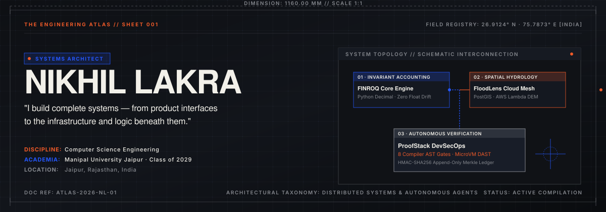
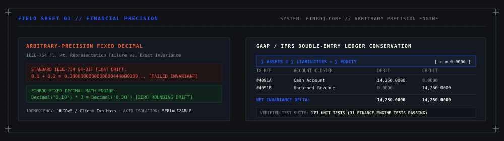
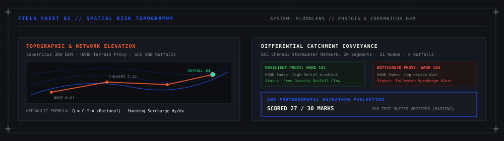
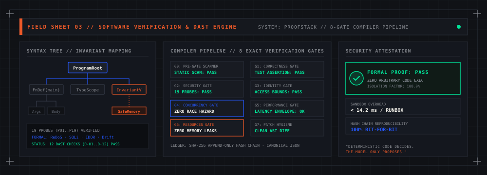
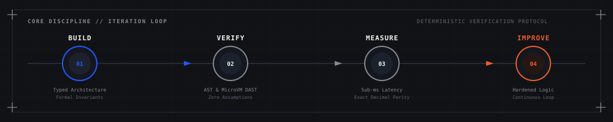

<div align="center">

<!-- ATLAS FRONTISPIECE PLATE -->


<br /><br />

<!-- ARCHITECTURAL INDEX DIRECTORY -->
<p align="center">
  <a href="https://nikhil-lakra.vercel.app/"><b>[ 01 // PORTFOLIO ]</b></a> &nbsp;&nbsp;·&nbsp;&nbsp;
  <a href="https://linkedin.com/in/nikhil-lakra-b4300a381"><b>[ 02 // LINKEDIN ]</b></a> &nbsp;&nbsp;·&nbsp;&nbsp;
  <a href="https://github.com/nikhillakra2007-tech"><b>[ 03 // GITHUB ]</b></a> &nbsp;&nbsp;·&nbsp;&nbsp;
  <a href="mailto:nikhillakra2007@gmail.com"><b>[ 04 // CONTACT ]</b></a>
</p>


</div>

<br />

```
ATLAS IDENTIFIER    : NL-ENG-2026.04
COORDINATES         : 26.9124° N, 75.7873° E [JAIPUR, RAJASTHAN]
AFFILIATION         : MANIPAL UNIVERSITY JAIPUR // DEPT. OF COMPUTER SCIENCE & ENGINEERING ('29)
RESEARCH DISCIPLINE : SYSTEMS ARCHITECTURE · DETERMINISTIC VERIFICATION · GEOSPATIAL COMPUTING
STATUS              : ACTIVE FIELD EXPERIMENTATION
```

---

## 01 // EXECUTIVE SUMMARY & DESIGN PHILOSOPHY

> **"Deterministic code decides. The generative model only proposes."**
> 
> *Software systems operating on high-consequence domains—capital allocation, municipal flood resilience, or automated code compilation—cannot tolerate stochastic ambiguity. I design and engineer products from first principles: mathematically verified data structures, strict runtime invariants, and defensible audit boundaries.*

I am **Nikhil Lakra**, a systems and full-stack software engineer based in Jaipur, India. My work focuses on building resilient end-to-end applications where computational rigor and thoughtful product interfaces intersect. Rather than surface-level wrappers, every project in this atlas is engineered around concrete domain constraints: double-entry ledger invariants, geospatial catchment elevation deltas, and multi-gate static compiler verification.

<br />

<div align="center">

</div>

<br />

## 02 // THE THREE FIELD STUDIES (ARCHITECTURAL PLATES)

Each project below is documented as an autonomous field sheet with verified domain formulas, architectural constraints, and live production endpoints.

---

### FIELD SHEET 01 // FINROQ — PRECISION FINANCIAL ENGINE
*High-Integrity Double-Entry Accounting & Ledger Verification Engine*

<div align="center">

</div>

<br />

```
SPECIFICATION   : GAAP / IFRS COMPLIANT DOUBLE-ENTRY ENGINE
INVARIANT       : ∑ Debits ≡ ∑ Credits  |  ∑ Assets ≡ ∑ Liabilities + ∑ Equity
NUMERIC TYPE    : Arbitrary-Precision Fixed-Point Decimal (Zero IEEE-754 Floating-Point Drift)
TRANSACTIONS    : ACID Isolation · Deterministic Idempotency Keys · Append-Only Audit Trail
TEST COVERAGE   : 177 Unit Tests (31 Dedicated Finance Engine Tests Passing)
STACK           : Next.js 14 · FastAPI · Python 3.12 · PostgreSQL · SQLAlchemy · TailwindCSS
REPOSITORIES    : https://github.com/nikhillakra2007-tech/finroq
DEPLOYMENT      : https://finroq-app.vercel.app/
```

#### Core Architectural Mechanics
- **Zero Float Drift Guarantee**: Standard 64-bit IEEE-754 floats introduce cumulative representation errors (`0.1 + 0.2 ≠ 0.3`). FinRoq enforces arbitrary-precision `Decimal` mathematics across all balance calculations, ledger postings, and reconciliation routines.
- **Mathematical Dual-Entry Invariants**: Every financial transaction must satisfy the fundamental conservation theorem $\sum \text{Debits} - \sum \text{Credits} = 0$. Incomplete, single-sided, or asymmetric journal entries are rejected at the database transaction layer.
- **Auditable Cryptographic Append-Log**: Historic ledger lines are strictly immutable; corrections are executed exclusively via dated countervailing journal adjustments, preserving an unbroken forensic transaction history.

<br />

<div align="center">

</div>

<br />

### FIELD SHEET 02 // FLOODLENS — SPATIAL RISK TOPOGRAPHY
*Geospatial Hydrologic Inundation Modeling & Stormwater Catchment Analysis*

<div align="center">

</div>

<br />

```
SPECIFICATION   : MUNICIPAL STORMWATER DRAINAGE & INUNDATION ATTRIBUTION
HYDROLOGIC MODEL: Rational Peak Runoff [ Q = C · I · A ] · Manning Surcharge dy/dx
SPATIAL ENGINE  : Copernicus 30m DEM · Height Above Nearest Drainage (HAND) · PostGIS
NETWORK SCOPE   : GCC SWD Network (Chennai Wards 101–104 · 20 Segments · 21 Nodes · 4 Outfalls)
AWS RECOGNITION : Scored 27 / 30 in an AWS Hackathon (203 Verified Tests Passing)
STACK           : Next.js 14 · FastAPI · AWS Lambda · PostgreSQL / PostGIS · Leaflet · GeoJSON
REPOSITORIES    : https://github.com/nikhillakra2007-tech/FloodLens
DEPLOYMENT      : https://floodlens-app.vercel.app/
```

#### Core Architectural Mechanics
- **PostGIS Geospatial Contours**: Inundation surfaces and storm drain culverts are modeled using topological polygons and vector streams. Spatial queries calculate run-time intersection of precipitation plumes with low-lying municipal wards.
- **Twin-Ward Catchment Differential**: Real-time comparative attribution between resilient catchments (Ward 101: high relief gradient, free gravity outfall) versus bottleneck catchments (Ward 104: depression bowl, tailwater surcharge alert).
- **Serverless Hydrologic Telemetry**: AWS Lambda computes peak runoff vectors using digital elevation gradients, delivering instant risk assessment maps without cold-start state bottlenecks.

<br />

<div align="center">

</div>

<br />

### FIELD SHEET 03 // PROOFSTACK — COMPILER VERIFICATION & DAST
*Multi-Stage Code Verification Pipeline & MicroVM Isolation Engine*

<div align="center">

</div>

<br />

```
SPECIFICATION   : AUTOMATED COMPILER AUDIT ENGINE // 8 DETERMINISTIC VERIFICATION GATES
EXACT GATES     : G0: Pre-Gate Scanner  →  G1: Correctness  →  G2: Security (19 Probes)
                  G3: Identity & Access  →  G4: Concurrency  →  G5: Performance
                  G6: Resource Telemetry →  G7: Patch Hygiene
DYNAMIC DAST    : 12 Automated Scanning Checks (D-01 to D-12) & 19 Targeted Security Probes
ISOLATION       : Ephemeral Docker / MicroVM Sandboxing (< 14.2ms startup overhead)
CRYPTOGRAPHY    : Append-Only SHA-256 Hash Chain with Canonical JSON (Bit-for-Bit Reproducibility)
STACK           : Next.js · Python 3.12 · FastAPI · AST Parsers · MicroVM Sandboxing · TailwindCSS
REPOSITORIES    : https://github.com/nikhillakra2007-tech/ProofStack
DEPLOYMENT      : https://proofstack-cockpit.vercel.app/
```

#### Core Architectural Mechanics
- **Deterministic AST Syntax Gateways**: Parses arbitrary LLM-generated or developer-submitted source code into Abstract Syntax Trees, evaluating formal safety bounds, illegal function invocations, and circular references prior to bytecode execution.
- **Ephemeral Sandbox Containment**: Untrusted code snippets run in resource-capped ephemeral MicroVMs with strict memory bounds, CPU quota throttling, and zero network breakout capability.
- **Cryptographic Evidence Sealing**: Verification verdicts and runtime execution telemetry are hashed into an immutable append-only SHA-256 hash chain with canonical JSON encoding, enabling deterministic third-party verification of audit receipts.

<br />

<div align="center">

</div>

<br />

## 03 // METHODOLOGY: THE ENGINEERING PROTOCOL

Every system in this repository is constructed through a deterministic, four-stage verification protocol:

<div align="center">

</div>

<br />

| Phase | Operational Focus | Engineering Criteria |
| :--- | :--- | :--- |
| **01 // BUILD** | **Architectural Drafting** | Explicit typed schemas, zero hidden state mutation, domain boundaries modeled as algebraic data types. |
| **02 // VERIFY** | **Formal Invariant Testing** | Syntax tree validation, fuzzing against boundary conditions, isolated microVM runtime execution. |
| **03 // MEASURE** | **Empirical Profiling** | Sub-millisecond latency tracking, zero decimal precision drift, verified spatial queries. |
| **04 // IMPROVE** | **Deterministic Hardening** | Iterative reduction of attack surfaces, cryptographic ledger sealing, continuous CI regression gates. |

<br />

<div align="center">

</div>

<br />

## 04 // COLOPHON & DIRECT CHANNELS

```
DOCUMENT SPEC   : THE ENGINEERING ATLAS // VOL. I
COMPOSITION     : PURE SVG FIELD PLATES · TECHNICAL DRAFTING SCHEMATICS · MARKDOWN GRID
PALETTE         : CHARCOAL [#101216] · DRAFTING CREAM [#F2F0E9] · BLUEPRINT [#2457FF] · ORANGE [#F05A28]
ENGINEER        : NIKHIL LAKRA
LOCATION        : JAIPUR, RAJASTHAN, INDIA [26.9124° N, 75.7873° E]
DIRECTORY       : PORTFOLIO (nikhil-lakra.vercel.app) · GITHUB (@nikhillakra2007-tech) · LINKEDIN (/in/nikhil-lakra-b4300a381)
```

<br />

<div align="center">

<p align="center">
  <a href="https://nikhil-lakra.vercel.app/"><b>[ PORTFOLIO ]</b></a> &nbsp;&nbsp;·&nbsp;&nbsp;
  <a href="https://linkedin.com/in/nikhil-lakra-b4300a381"><b>[ LINKEDIN ]</b></a> &nbsp;&nbsp;·&nbsp;&nbsp;
  <a href="https://github.com/nikhillakra2007-tech"><b>[ GITHUB ]</b></a> &nbsp;&nbsp;·&nbsp;&nbsp;
  <a href="mailto:nikhillakra2007@gmail.com"><b>[ EMAIL ]</b></a>
</p>

<br />

<sub>© 2026 Nikhil Lakra. All system schematics, domain proofs, and field sheets independently authored.</sub>

</div>
