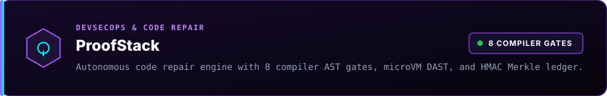
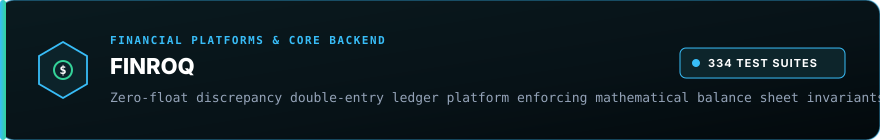
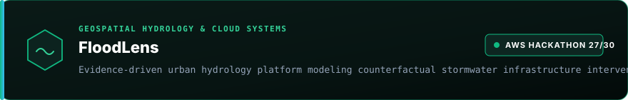

<!-- CINEMATIC ANIME HERO -->

  

<!-- QUICK ACCESS LINKS -->

  
  &nbsp;
  
  &nbsp;
  
  &nbsp;
  

 

  

## ABOUT

> **B.Tech Computer Science student at Manipal University Jaipur ('29)** building full-stack applications, distributed backend services, and evidence-grounded AI systems. Focused on deterministic compiler verification, zero-float financial ledgers, and low-latency telemetry pipelines. Operating under one core principle:
> 
> *“Deterministic code decides. The generative model only proposes.”*

 

 

## FEATURED PROJECTS

<!-- PROJECT 1: PROOFSTACK -->

  Autonomous DevSecOps engine enforcing 8 compiler AST gates, 12-vector live microVM DAST, and an HMAC-SHA256 Merkle evidence ledger. 
  <b>Tech:</b> <code>Python 3.12</code> · <code>NVIDIA Nemotron</code> · <code>Tree-sitter AST</code> · <code>FastAPI</code> · <code>Next.js 14</code> 
  🔗 <a href="https://github.com/nikhillakra2007-tech/ProofStack"><b>GitHub Repository</b></a> &nbsp;|&nbsp; 🌐 <a href="https://proofstack-cockpit.vercel.app/"><b>Live Cockpit</b></a>

 

<!-- PROJECT 2: FINROQ -->

  Zero-float discrepancy core accounting platform enforcing mathematical balance sheet invariants across 334 automated test suites. 
  <b>Tech:</b> <code>Python Decimal</code> · <code>FastAPI</code> · <code>PostgreSQL 16</code> · <code>SQLAlchemy 2.0</code> · <code>Next.js 14</code> 
  🔗 <a href="https://github.com/nikhillakra2007-tech/finroq"><b>GitHub Repository</b></a> &nbsp;|&nbsp; 🌐 <a href="https://finroq-app.vercel.app/"><b>Live Platform</b></a>

 

<!-- PROJECT 3: FLOODLENS -->

  Evidence-driven urban hydrology platform modeling counterfactual stormwater infrastructure interventions (Scored <b>27/30</b> in AWS Environmental Hackathon). 
  <b>Tech:</b> <code>AWS Lambda</code> · <code>CloudFormation IaC</code> · <code>Python 3.12</code> · <code>PostGIS</code> · <code>Docker</code> 
  🔗 <a href="https://github.com/nikhillakra2007-tech/FloodLens"><b>GitHub Repository</b></a> &nbsp;|&nbsp; 🌐 <a href="https://floodlens-app.vercel.app/"><b>Live Application</b></a>

 

 

## TECHNOLOGIES

 

  

Nikhil Lakra &bull; 2026 &bull; Jaipur, India

