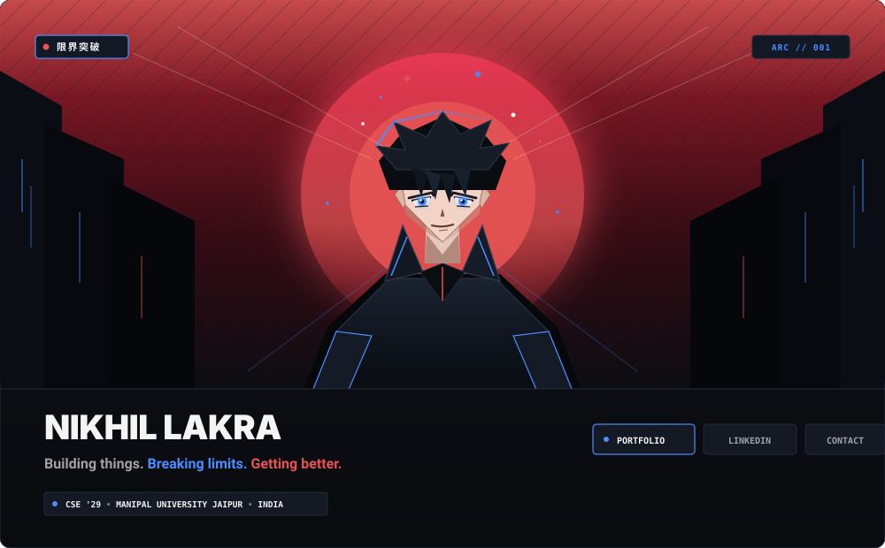
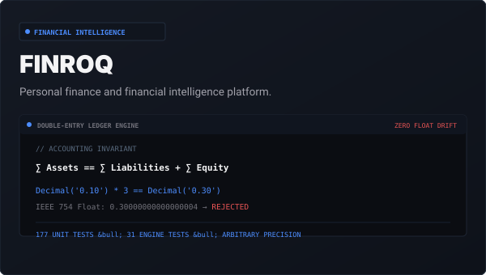
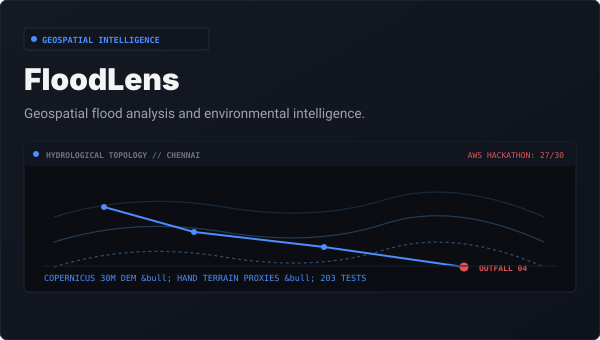
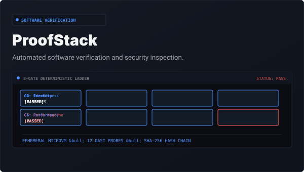
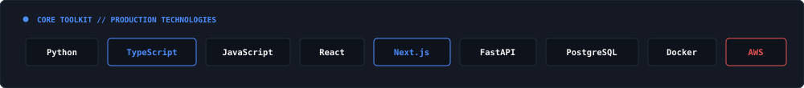

<!-- SECTION 01 — CINEMATIC HERO -->

 

<!-- SECTION 02 — SHORT INTRODUCTION -->
> Computer Science student and product builder exploring full-stack engineering, AI and intelligent systems. I enjoy turning ambitious ideas into working products.

 

### SELECTED WORK

<table>
  <tr>
    <td width="33.33%" valign="top">
      
        
      <strong>FINROQ</strong>
       
      Personal finance and financial intelligence platform.
        
      <a href="https://finroq-app.vercel.app/"><strong>Live App ↗</strong></a> &nbsp;&bull;&nbsp; <a href="https://github.com/nikhillakra2007-tech/finroq"><strong>Code ↗</strong></a>
    </td>
    <td width="33.33%" valign="top">
      
        
      <strong>FloodLens</strong>
       
      Geospatial flood analysis and environmental intelligence.
        
      <a href="https://floodlens-app.vercel.app/"><strong>Live App ↗</strong></a> &nbsp;&bull;&nbsp; <a href="https://github.com/nikhillakra2007-tech/FloodLens"><strong>Code ↗</strong></a>
    </td>
    <td width="33.33%" valign="top">
      
        
      <strong>ProofStack</strong>
       
      Automated software verification and security inspection.
        
      <a href="https://proofstack-cockpit.vercel.app/"><strong>Live App ↗</strong></a> &nbsp;&bull;&nbsp; <a href="https://github.com/nikhillakra2007-tech/ProofStack"><strong>Code ↗</strong></a>
    </td>
  </tr>
</table>

 

### MY TOOLKIT

  

 

---

  <a href="https://nikhil-lakra.vercel.app/"><strong>Portfolio</strong></a> &nbsp;&bull;&nbsp;
  <a href="https://linkedin.com/in/nikhil-lakra-b4300a381"><strong>LinkedIn</strong></a> &nbsp;&bull;&nbsp;
  <a href="https://github.com/nikhillakra2007-tech"><strong>GitHub</strong></a> &nbsp;&bull;&nbsp;
  <a href="mailto:nikhillakra2007@gmail.com"><strong>Email</strong></a>

Nikhil Lakra &bull; 2026

