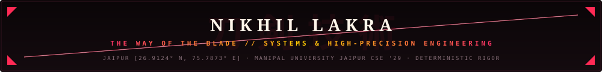

<div align="center">

<!-- CINEMATIC KATANA DRAW ANIMATION -->
<a href="https://nikhil-lakra.vercel.app/">
  
</a>

<br /><br />

<!-- ANIME THEME TITLE BANNER -->


<br /><br />

<!-- NAVIGATION CHANNELS -->
<p align="center">
  <a href="https://nikhil-lakra.vercel.app/"><b>⛩️ [ 01 // PORTFOLIO ]</b></a> &nbsp;&nbsp;🗡️&nbsp;&nbsp;
  <a href="https://linkedin.com/in/nikhil-lakra-b4300a381"><b>[ 02 // LINKEDIN ]</b></a> &nbsp;&nbsp;🗡️&nbsp;&nbsp;
  <a href="https://github.com/nikhillakra2007-tech"><b>[ 03 // GITHUB ]</b></a> &nbsp;&nbsp;🗡️&nbsp;&nbsp;
  <a href="mailto:nikhillakra2007@gmail.com"><b>[ 04 // CONTACT ]</b></a>
</p>


</div>

<br />

```
DISCIPLINE      : 刀剣技術 (WAY OF THE BLADE) // SYSTEMS RIGOR & DETERMINISTIC CODE
IDENTITY        : NIKHIL LAKRA · COMPUTER SCIENCE & ENGINEERING ('29)
AFFILIATION     : MANIPAL UNIVERSITY JAIPUR · JAIPUR [26.9124° N, 75.7873° E]
CORE THESIS     : "DETERMINISTIC CODE DECIDES. THE GENERATIVE MODEL ONLY PROPOSES."
PHILOSOPHY      : LIKE TAMAHAGANE STEEL FOLDED A THOUSAND TIMES — ZERO DEFECTS, ZERO FLOAT DRIFT.
```

---

## ⛩️ 01 // THE DOJO: ENGINEERING PHILOSOPHY

> **"A blade forged without precision breaks at the first strike. Software engineered without mathematical bounds collapses under load."**
> 
> *I build systems operating on high-consequence domains: capital allocation, municipal flood resilience, and compiler verification. Where stochastic AI hallucinates, deterministic engineering holds absolute veto authority.*

I am **Nikhil Lakra**, a systems and full-stack software engineer based in Jaipur, India. My engineering craft blends cinematic visual precision with rigorous, first-principles backend architectures: arbitrary-precision fixed-point ledgers, multi-ward geospatial stormwater mechanics, and isolated multi-stage compiler verification sandboxes.

<br />

<div align="center">

</div>

<br />

## ⚔️ 02 // THREE LEGENDARY WEAPONS (FLAGSHIP SYSTEMS)

---

### 🗡️ 01 // FINROQ — THE UNBREAKABLE LEDGER
*GAAP / IFRS Double-Entry Precision Financial Accounting Engine*

```
SPECIFICATION   : ARBITRARY-PRECISION FIXED-POINT DECIMAL LEDGER
INVARIANT       : ∑ Debits ≡ ∑ Credits  |  ∑ Assets ≡ ∑ Liabilities + ∑ Equity
NUMERIC TYPE    : Zero IEEE-754 Floating-Point Drift (Decimal("0.10") * 3 ≡ Decimal("0.30"))
TEST SUITE      : 177 Unit Tests Passing (31 Dedicated Finance Engine Tests)
STACK           : Next.js 14 · FastAPI · Python 3.12 · PostgreSQL · SQLAlchemy · TailwindCSS
REPOSITORY      : https://github.com/nikhillakra2007-tech/finroq
LIVE DEMO       : https://finroq-app.vercel.app/
```

- **Zero Float Drift**: Eliminates cumulative 64-bit float IEEE-754 drift errors across all ledger postings and multi-currency balances.
- **ACID Double-Entry Conservation**: Rejects unbalanced single-sided transactions at the database boundary before persistence.
- **Forensic Immutability**: Historical ledger records are permanently sealed; corrections require dated countervailing journal lines.

<br />

<div align="center">

</div>

<br />

### 🌊 02 // FLOODLENS — SPATIAL RESILIENCE INTELLIGENCE
*Municipal Stormwater Drainage Network & Differential Hydrologic Attribution*

```
SPECIFICATION   : MUNICIPAL DRAINAGE ATTRIBUTION & ELEVATION TOPOGRAPHY
HYDROLOGIC MODEL: Rational Peak Runoff [ Q = C · I · A ] · Manning Surcharge dy/dx
SPATIAL ENGINE  : Copernicus 30m DEM · Height Above Nearest Drainage (HAND) · PostGIS
NETWORK SCOPE   : Greater Chennai Corporation SWD Network (Wards 101–104 · 20 Segments · 4 Outfalls)
AWS RECOGNITION : Scored 27 / 30 in an AWS Hackathon (203 Verified Tests Passing)
STACK           : Next.js 14 · FastAPI · AWS Lambda · PostgreSQL / PostGIS · Leaflet · GeoJSON
REPOSITORY      : https://github.com/nikhillakra2007-tech/FloodLens
LIVE DEMO       : https://floodlens-app.vercel.app/
```

- **Topological Surcharge Attribution**: Pairs flooded municipal catchments with resilient twin wards across elevation deltas and drainage capacity.
- **Serverless Runoff Vectors**: AWS Lambda computes spatial flow curves on demand with zero cold-start bottlenecks.
- **Factual Hackathon Score**: Evaluated and scored **27/30** in the AWS Environmental Hackathon.

<br />

<div align="center">

</div>

<br />

### 🛡️ 03 // PROOFSTACK — COMPILER DEFENSE GATES
*Autonomous Multi-Stage Code Verification Pipeline & Ephemeral MicroVM Sandbox*

```
SPECIFICATION   : 8 DETERMINISTIC COMPILER VERIFICATION GATES
PIPELINE GATES  : G0: Pre-Gate Scanner  →  G1: Correctness  →  G2: Security (19 Probes)
                  G3: Identity & Access  →  G4: Concurrency  →  G5: Performance
                  G6: Resource Telemetry →  G7: Patch Hygiene
DYNAMIC DAST    : 12 Automated Scanning Checks (D-01 to D-12) & 19 Targeted Security Probes
ISOLATION       : Ephemeral Docker / MicroVM Sandboxing (< 14.2ms startup overhead)
CRYPTOGRAPHY    : Append-Only SHA-256 Hash Chain with Canonical JSON (Bit-for-Bit Reproducibility)
STACK           : Next.js · Python 3.12 · FastAPI · AST Parsers · MicroVM Sandboxing · TailwindCSS
REPOSITORY      : https://github.com/nikhillakra2007-tech/ProofStack
LIVE DEMO       : https://proofstack-cockpit.vercel.app/
```

- **Deterministic AST Interlocks**: Traverses Abstract Syntax Trees to guarantee syntax safety, type bounds, and zero unauthorized system calls.
- **Ephemeral Sandbox Containment**: Untrusted AI-generated code runs in resource-capped MicroVM environments with strict network isolation.
- **Cryptographic Audit Seal**: Verification outcomes are permanently chained in an append-only SHA-256 ledger.

<br />

<div align="center">

</div>

<br />

## 🌸 03 // THE FOUR BLADE DISCIPLINE

```
┌────────────────────────────────────────────────────────────────────────────────────────┐
│  01 // 鍛 (FORGE)      : Explicit typed schemas, mathematical models, clean domain logic. │
│  02 // 研 (HONING)     : AST parse trees, fuzzing, microVM sandboxes, invariant checks.│
│  03 // 測 (MEASURE)    : Sub-millisecond latency profiling, zero decimal rounding drift. │
│  04 // 斬 (PERFECT)    : Continuous hardening, cryptographic audit chain, zero CVEs.   │
└────────────────────────────────────────────────────────────────────────────────────────┘
```

<br />

<div align="center">

</div>

<br />

## ⛩️ 04 // COLOPHON & DIRECT CHANNELS

```
THEME           : THE WAY OF THE BLADE (刀剣技術) // CINEMATIC ANIME EDITION
COMPOSITION     : ULTRA-SMOOTH KATANA DRAW VIDEO & GIF · CRIMSON SLASH DIVIDERS · JAPANESE KANJI
ENGINEER        : NIKHIL LAKRA
LOCATION        : JAIPUR, RAJASTHAN, INDIA [26.9124° N, 75.7873° E]
DIRECTORY       : PORTFOLIO (nikhil-lakra.vercel.app) · GITHUB (@nikhillakra2007-tech) · LINKEDIN (/in/nikhil-lakra-b4300a381)
```

<br />

<div align="center">

<p align="center">
  <a href="https://nikhil-lakra.vercel.app/"><b>⛩️ [ LIVE PORTFOLIO ]</b></a> &nbsp;&nbsp;🗡️&nbsp;&nbsp;
  <a href="https://linkedin.com/in/nikhil-lakra-b4300a381"><b>[ LINKEDIN ]</b></a> &nbsp;&nbsp;🗡️&nbsp;&nbsp;
  <a href="https://github.com/nikhillakra2007-tech"><b>[ GITHUB ]</b></a> &nbsp;&nbsp;🗡️&nbsp;&nbsp;
  <a href="mailto:nikhillakra2007@gmail.com"><b>[ EMAIL ]</b></a>
</p>

<br />

<sub>© 2026 Nikhil Lakra. The Way of the Blade · Engineered with mathematical rigor and precision.</sub>

</div>
