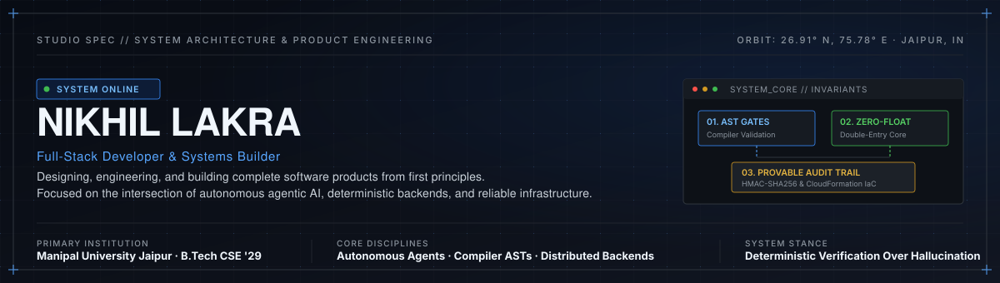
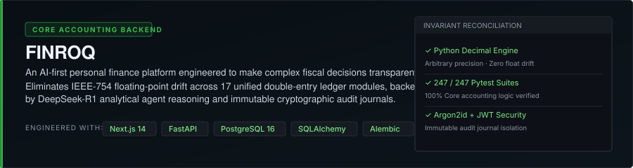
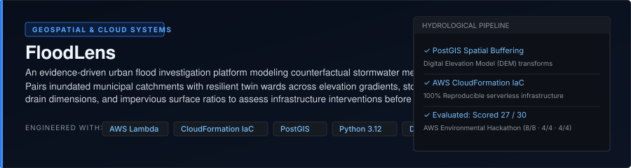
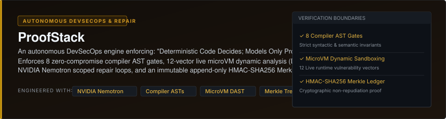
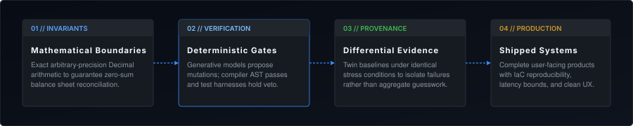

<!-- HERO BANNER -->

  

<!-- NAVIGATION PILLS -->
<a href="https://myself-lyart-theta.vercel.app/"><b>Portfolio</b></a> &nbsp;•&nbsp;
<a href="https://linkedin.com/in/nikhil-lakra"><b>LinkedIn</b></a> &nbsp;•&nbsp;
<a href="https://github.com/nikhillakra2007-tech"><b>GitHub</b></a> &nbsp;•&nbsp;
<a href="mailto:nikhillakra2007@gmail.com"><b>Contact</b></a>

  

## 01 / IDENTITY

> **"Full-stack developer building AI-powered products and reliable software systems."**
> 
> *Interested in the intersection of product engineering, intelligent systems, and infrastructure.*

I am **Nikhil Lakra**, a developer and B.Tech student in Computer Science ('29) at Manipal University Jaipur. 

My work centers on designing, engineering, and building complete software products from first principles. Rather than building isolated demos, I focus on the full lifecycle of software engineering: strict database schemas and transaction isolation, deterministic backend services, autonomous agentic AI workflows, and thoughtful user-facing product experiences.

---

## 02 / SELECTED WORK

A selection of three flagship systems engineered across financial architecture, geospatial cloud infrastructure, and autonomous DevSecOps.

 

### 01 · FINROQ — Core Accounting Backend & Personal Finance Engine

* **Core Focus:** An AI-first personal finance platform engineered to make complex fiscal decisions transparent and verifiable.
* **Engineering Highlights:**
  * Eliminates IEEE-754 floating-point drift across 17 unified modules by enforcing strict arbitrary-precision `Python Decimal` arithmetic at the database transaction layer.
  * Backed by DeepSeek-R1 analytical reasoning agents for contextual financial insights, Argon2id cryptographic password derivation, and immutable audit journals.
  * Automated migration lifecycle managed through versioned Alembic revisions and 247/247 passing Pytest backend validation suites.
* **Stack:** `Python Decimal` · `FastAPI` · `PostgreSQL 16` · `SQLAlchemy` · `Alembic` · `Next.js 14` · `Docker`
* **Links:** [GitHub Repository](https://github.com/nikhillakra2007-tech/finroq) &nbsp;|&nbsp; [Live Application](https://finroq-app.vercel.app/)

 

### 02 · FloodLens — Geospatial Urban Hydrology & Intervention Engine

* **Core Focus:** An evidence-driven urban flood investigation platform that models counterfactual stormwater mechanisms before cloudburst events occur.
* **Engineering Highlights:**
  * Pairs inundated municipal catchments with resilient twin wards across elevation gradients, stormwater drain (SWD) conduit dimensions, and impervious surface ratios.
  * Distributed serverless backend with stateless AWS Lambda workers executing chunked Digital Elevation Model (DEM) transforms and spatial buffering in PostGIS.
  * Built with 100% reproducible AWS CloudFormation Infrastructure as Code (IaC) templates and calibrated against historical urban inundation data.
  * **Evaluation Record:** Scored **27 / 30** in the *AWS Environmental Hackathon* (Idea & Impact: 8/8 · Execution: 4/4 · Design: 4/4).
* **Stack:** `AWS Lambda` · `CloudFormation IaC` · `PostGIS` · `PostgreSQL` · `Python 3.12` · `Next.js 14` · `Docker`
* **Links:** [GitHub Repository](https://github.com/nikhillakra2007-tech/FloodLens) &nbsp;|&nbsp; [Live Application](https://floodlens-app.vercel.app/)

 

### 03 · ProofStack — Autonomous DevSecOps & Code Repair Harness

* **Core Focus:** An autonomous DevSecOps and code repair verification engine enforcing the rule: *"Deterministic Code Decides; The Generative Model Only Proposes."*
* **Engineering Highlights:**
  * Guards pull requests with 8 zero-compromise compiler AST validation passes and 12-vector dynamic analysis (DAST) inside isolated microVM sandboxes.
  * Couples NVIDIA Nemotron scoped repair loops with an immutable append-only HMAC-SHA256 Merkle evidence ledger to guarantee audit non-repudiation.
  * Prevents stochastic LLM code hallucinations from reaching production environments without passing deterministic static and dynamic verification gates.
* **Stack:** `Python 3.12` · `NVIDIA Nemotron` · `Compiler AST Parsing` · `MicroVM DAST` · `Merkle Trees` · `FastAPI` · `Next.js 14`
* **Links:** [GitHub Repository](https://github.com/nikhillakra2007-tech/ProofStack) &nbsp;|&nbsp; [Live Cockpit](https://proofstack-cockpit.vercel.app/)

 

  

## 03 / ENGINEERING APPROACH

How I think about building software and systems:

 

 

1. **Build complete systems, not disconnected demos.** Engineering value lives in complete lifecycles: clean data models, transaction isolation, error handling, performance bounds, and production deployment rather than throwaway prototypes.
2. **Treat database design and backend architecture as first-class concerns.** Correct persistence boundaries (PostgreSQL, PostGIS spatial indexing, arbitrary-precision Decimal arithmetic, connection pooling) prevent architectural debt before user-facing layers are built.
3. **Prioritize reliability, verification, and maintainability.** Generative models propose candidate changes; compiler ASTs, type systems, and deterministic test harnesses hold veto authority.
4. **Combine user experience with technical depth.** A reliable distributed system deserves a clear, responsive interface. Latency bounds, visual hierarchy, and performance matter as much as backend algorithmic correctness.
5. **Experiment with AI where it creates real utility.** Focus on scoped reasoning loops, structured tool execution, and deterministic validation where intelligent systems solve concrete problems.

---

## 04 / CURRENT EXPLORATION

Topics and architectures currently under active study and prototyping:

* **Autonomous Software Verification & Compiler ASTs:** Exploring deeper AST traversal passes and isolated sandboxes to safely analyze and constrain AI-generated code mutations.
* **Agentic AI Orchestration:** Investigating multi-agent decomposition patterns, tool-calling validation, and verifiable execution pipelines.
* **High-Throughput Streaming Telemetry:** Prototyping real-time GTFS-Realtime protocol ingestion with sub-150ms sliding-window headway calculations to detect transit bottlenecks before stoppages occur.
* **Geospatial & Hydrological Modeling:** Refining counterfactual infrastructure intervention models with vector tile streaming and distributed elevation data pipelines.

---

## 05 / CONNECT

Have an interesting problem to solve or something worth building? Let's connect.

* **Portfolio:** [myself-lyart-theta.vercel.app](https://myself-lyart-theta.vercel.app/)
* **LinkedIn:** [linkedin.com/in/nikhil-lakra](https://linkedin.com/in/nikhil-lakra)
* **GitHub:** [github.com/nikhillakra2007-tech](https://github.com/nikhillakra2007-tech)
* **Email:** [nikhillakra2007@gmail.com](mailto:nikhillakra2007@gmail.com)

 

  
   
  NIKHIL LAKRA // THE ENGINEERING STUDIO · 2026

