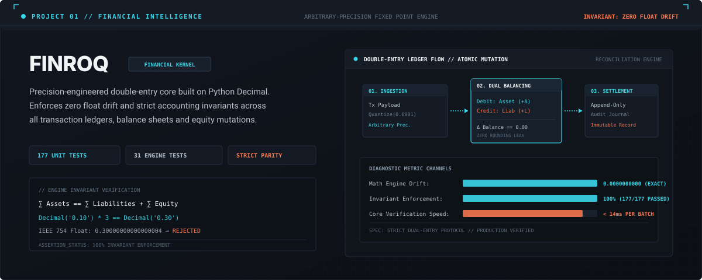
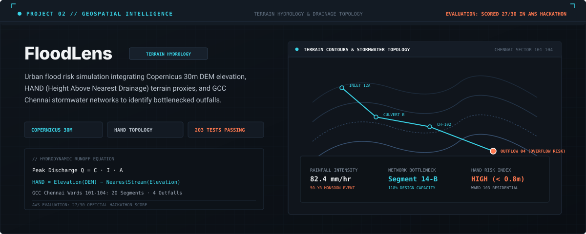
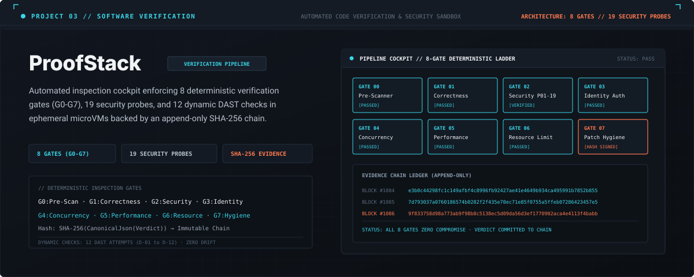
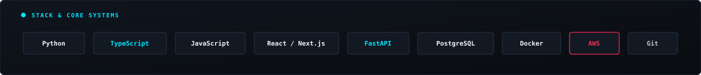

<div align="center">

<!-- ANIME PROTAGONIST HERO -->
<a href="https://nikhil-lakra.vercel.app/">
  
</a>

<p align="center">
  <a href="https://nikhil-lakra.vercel.app/"><strong>Portfolio</strong></a> &nbsp;&bull;&nbsp;
  <a href="https://linkedin.com/in/nikhil-lakra-b4300a381"><strong>LinkedIn</strong></a> &nbsp;&bull;&nbsp;
  <a href="https://github.com/nikhillakra2007-tech"><strong>GitHub</strong></a> &nbsp;&bull;&nbsp;
  <a href="mailto:nikhillakra2007@gmail.com"><strong>Contact</strong></a>
</p>

</div>


### `// ABOUT THE BUILDER`

> *"Computer Science student and product builder exploring full-stack engineering, AI and intelligent systems. I enjoy turning ambitious ideas into working products."*

**Discipline:** Computer Science &amp; Engineering &bull; **Class of 2029**  
**Institution:** Manipal University Jaipur &bull; **Location:** India  

---

### `// FEATURED PROJECTS`

Here is what I have been engineering recently:

#### 01 / FINROQ &mdash; Personal Finance &amp; Financial Intelligence

> **Personal finance and financial intelligence platform built around arbitrary-precision double-entry arithmetic.**

<div align="center">
  <a href="https://finroq-app.vercel.app/">
    
  </a>
</div>

- **Focus:** Arbitrary-precision double-entry core built on Python `Decimal`. Enforces strict accounting balance sheets with zero floating-point rounding drift.
- **Verification:** 177 unit tests and 31 dedicated financial engine tests.

```
[ LIVE DEMO ]   → https://finroq-app.vercel.app/
[ REPOSITORY ]  → https://github.com/nikhillakra2007-tech/finroq
```

---

#### 02 / FloodLens &mdash; Geospatial Flood Analysis &amp; Environmental Intelligence

> **Urban flood risk simulation integrating Copernicus 30m DEM elevation and municipal stormwater networks.**

<div align="center">
  <a href="https://floodlens-app.vercel.app/">
    
  </a>
</div>

- **Focus:** Models catchment terrain elevation using Copernicus 30m DEM and HAND proxies, simulating stormwater routing across GCC Chennai Wards 101–104.
- **Verification:** Scored **27/30 in an AWS Hackathon**; backed by 203 automated test suites.

```
[ LIVE DEMO ]   → https://floodlens-app.vercel.app/
[ REPOSITORY ]  → https://github.com/nikhillakra2007-tech/FloodLens
```

---

#### 03 / ProofStack &mdash; Automated Software Verification &amp; Security Cockpit

> **Automated verification pipeline enforcing 8 deterministic inspection gates and SHA-256 evidence chains.**

<div align="center">
  <a href="https://proofstack-cockpit.vercel.app/">
    
  </a>
</div>

- **Focus:** Deterministic 8-gate gauntlet (`G0: Pre-Scan` through `G7: Patch Hygiene`) with 19 security probes, 12 dynamic DAST checks, and ephemeral microVM code isolation.
- **Verification:** Every gate verdict is canonicalized into an append-only cryptographic audit chain.

```
[ LIVE DEMO ]   → https://proofstack-cockpit.vercel.app/
[ REPOSITORY ]  → https://github.com/nikhillakra2007-tech/ProofStack
```


### `// MY ACTIVITY // THE GRIND NEVER STOPS`

<p align="center">
  <a href="https://github.com/nikhillakra2007-tech">
    
  </a>
  &nbsp;&nbsp;
  <a href="https://github.com/nikhillakra2007-tech">
    
  </a>
</p>


### `// TECHNICAL STACK`

<div align="center">
  
</div>


### `// DISPATCH & CHANNELS`

```
OPERATOR : Nikhil Lakra
ROLE     : Full-Stack Engineer & Intelligent Systems Builder
PORTFOLIO: https://nikhil-lakra.vercel.app/
LINKEDIN : https://linkedin.com/in/nikhil-lakra-b4300a381
GITHUB   : https://github.com/nikhillakra2007-tech
DIRECT   : nikhillakra2007@gmail.com
```

<div align="center">
  <sub>NIKHIL LAKRA &bull; PROTAGONIST ARC &bull; 限界突破 &bull; 2026</sub>
</div>
