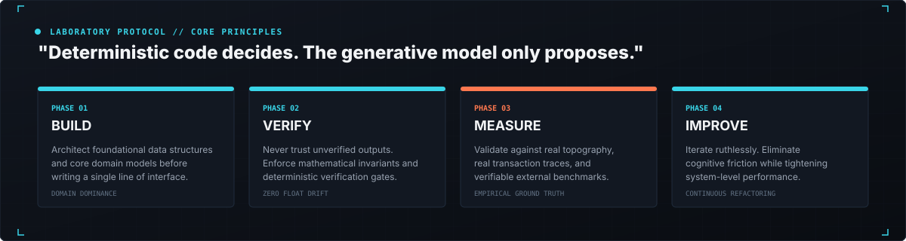

<div align="center">

<!-- HERO PLATE -->
<a href="https://nikhil-lakra.vercel.app/">
  
</a>

<p align="center">
  <a href="https://nikhil-lakra.vercel.app/"><strong>Portfolio</strong></a> &nbsp;&bull;&nbsp;
  <a href="https://linkedin.com/in/nikhil-lakra-b4300a381"><strong>LinkedIn</strong></a> &nbsp;&bull;&nbsp;
  <a href="https://github.com/nikhillakra2007-tech"><strong>GitHub</strong></a> &nbsp;&bull;&nbsp;
  <a href="mailto:nikhillakra2007@gmail.com"><strong>Contact</strong></a>
</p>

</div>


### `// SELECTED SYSTEMS & ENGINEERING WORK`

The focus of this laboratory is building robust, verifiable software systems — from low-latency financial ledgers and geospatial flood modeling to automated code verification pipelines.

---

#### 01 / FINROQ &mdash; Financial Intelligence Kernel

> **Arbitrary-precision double-entry financial ledger enforcing mathematical invariants and zero float drift.**

<div align="center">
  <a href="https://finroq-app.vercel.app/">
    
  </a>
</div>

- **The Problem:** Standard floating-point arithmetic (`IEEE 754`) produces drift in financial applications (e.g., `0.1 + 0.2 != 0.3`). Uncontrolled float conversions in accounting pipelines cause cumulative reconciliation errors, rounding leaks, and invalid balance sheets.
- **The Architecture:** FINROQ implements an arbitrary-precision accounting engine built on Python `Decimal`. Every transaction enforces double-entry balancing ($\sum \text{Assets} \equiv \sum \text{Liabilities} + \sum \text{Equity}$) before persistence.
- **Verified Metrics & Invariants:**
  - **177 Unit Tests & 31 Engine Tests** validating zero float drift across high-frequency journal entries.
  - **Atomic Balance Updates:** Eliminates rounding leaks by quantizing every intermediate calculation to defined currency bases.
  - **Audit Journal:** Append-only ledger format ensuring deterministic state reconstruction.

```
[ LIVE APPLICATION ] → https://finroq-app.vercel.app/
[ SOURCE REPOSITORY ] → https://github.com/nikhillakra2007-tech/finroq
```

---

#### 02 / FloodLens &mdash; Geospatial Terrain Hydrology

> **Urban flood risk simulation integrating Copernicus 30m DEM elevation and stormwater network topology.**

<div align="center">
  <a href="https://floodlens-app.vercel.app/">
    
  </a>
</div>

- **The Problem:** Urban flood predictions typically rely on static contour maps or coarse regional alerts, failing to model how street-level stormwater drains and local terrain depressions interact during severe monsoon events.
- **The Architecture:** FloodLens models catchment hydrology by pairing Copernicus 30m Digital Elevation Models (DEM) with HAND (Height Above Nearest Drainage) proxies. It simulates runoff routing against actual Greater Chennai Corporation (GCC) stormwater drain networks (Wards 101–104).
- **Verified Metrics & Invariants:**
  - **Evaluation:** Scored **27/30 in an AWS Hackathon** for geospatial modeling and technical implementation.
  - **Runoff Calculations:** Hydrodynamic peak discharge modeling using the Rational method ($Q = C \cdot I \cdot A$).
  - **Network Topology:** Pinpoints capacity exceedances across 20 stormwater segments and 4 municipal outfalls.
  - **203 Automated Tests** verifying hydrological routing algorithms.

```
[ LIVE APPLICATION ] → https://floodlens-app.vercel.app/
[ SOURCE REPOSITORY ] → https://github.com/nikhillakra2007-tech/FloodLens
```

---

#### 03 / ProofStack &mdash; Deterministic Code Verification Cockpit

> **Automated verification pipeline enforcing 8 deterministic inspection gates and SHA-256 evidence ledgers.**

<div align="center">
  <a href="https://proofstack-cockpit.vercel.app/">
    
  </a>
</div>

- **The Problem:** LLM-generated software patches and automated code suggestions frequently introduce subtle vulnerabilities, concurrency race conditions, or unverified hallucinations that standard linters miss.
- **The Architecture:** ProofStack runs submitted patches through an automated 8-gate inspection gauntlet (`G0: Pre-Scan` through `G7: Patch Hygiene`). The workload executes inside isolated, ephemeral microVM execution sandboxes and logs every verdict into an append-only hash chain.
- **Verified Metrics & Invariants:**
  - **8 Rigid Inspection Gates:** Syntactic correctness, security vulnerability analysis, concurrency verification, and memory safety.
  - **19 Security Probes (`P01`–`P19`):** Detecting command injection, secret leakage, and privilege escalation vectors.
  - **12 Dynamic DAST Checks (`D-01`–`D-12`):** Active runtime probing in sandboxed microVMs.
  - **Cryptographic Evidence Chain:** Each gate verdict is canonicalized and hashed via SHA-256 into a verifiable tamper-proof audit trail.

```
[ LIVE APPLICATION ] → https://proofstack-cockpit.vercel.app/
[ SOURCE REPOSITORY ] → https://github.com/nikhillakra2007-tech/ProofStack
```


### `// ENGINEERING PROTOCOL & PHILOSOPHY`

> *"Deterministic code decides. The generative model only proposes."*

<div align="center">
  
</div>

<br />

| Dimension | Engineering Standard |
| :--- | :--- |
| **System Invariants** | Domain models must be provably consistent before interfaces are written. Float arithmetic is never used where exact decimal accounting is required. |
| **Verification First** | Automated verification gates, strict unit tests, and continuous regression testing precede deployment. |
| **Real-World Grounding** | Models are validated against empirical datasets &mdash; whether satellite topography, municipal drainage networks, or real audit trails. |
| **Stack & Infrastructure** | Full-stack engineering across TypeScript, Python, Next.js, FastAPI, Node.js, PostgreSQL, Docker, AWS, and modern systems tooling. |


### `// IDENTITY & CHANNELS`

```
OPERATOR      : Nikhil Lakra
DISCIPLINE    : Computer Science & Engineering (Class of 2029)
INSTITUTION   : Manipal University Jaipur, India
RESEARCH FOCUS: Intelligent Systems, Full-Stack Architecture, Applied AI & Verification
PORTFOLIO     : https://nikhil-lakra.vercel.app/
LINKEDIN      : https://linkedin.com/in/nikhil-lakra-b4300a381
GITHUB        : https://github.com/nikhillakra2007-tech
DIRECT DISPATCH: nikhillakra2007@gmail.com
```

<div align="center">
  <sub>INTELLIGENT MACHINES LAB &bull; VERIFIED REPOSITORY ARTIFACT &bull; 2026</sub>
</div>
