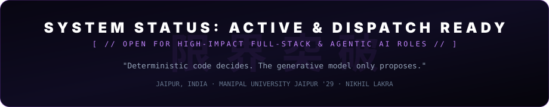

<div align="center">

<!-- HERO BANNER -->


<br/>

<!-- ANIMATED TYPING SUBTITLE -->


<br/>

<!-- QUICK ACCESS HUD BAR -->
<p align="center">
  <a href="https://myself-lyart-theta.vercel.app">
    
  </a>
  <a href="https://linkedin.com/in/nikhil-lakra-b4300a381">
    
  </a>
  <a href="mailto:nikhillakra2007@gmail.com">
    
  </a>
  <a href="https://github.com/nikhillakra2007-tech?tab=repositories">
    
  </a>
</p>

<!-- SECTION DIVIDER -->


</div>

## 👤 CHARACTER PROFILE // 人物調書

```ini
[IDENTIFICATION_RECORD]
NAME           = "Nikhil Lakra" [ ニキル・ラクラ ]
CLASS          = "Full-Stack & AI Systems Architect"
CLASSIFICATION = "SPECIAL GRADE [特級呪術師 // SHADOW MONARCH]"
AFFILIATION    = "Manipal University Jaipur — B.Tech Computer Science ('29)"
LOCATION       = "Jaipur, India [26.9124° N, 75.7873° E]"
CORE_INVARIANT = "Deterministic Code Decides; The Generative Model Only Proposes."
SYSTEM_STATUS  = "ONLINE // COMBAT-READY FOR HIGH-IMPACT ROLES"
```

> **"Nothing ships until a test or an exploit replay proves it."**
> 
> B.Tech Computer Science student at **Manipal University Jaipur** who architects and ships software end-to-end: high-throughput distributed backends, resilient full-stack systems, and evidence-grounded agentic AI pipelines. Rejecting superficial AI demos in favor of strict mathematical invariants, compiler AST validation, and microVM dynamic security sandboxes.

<br/>

<div align="center">

</div>

## ⚡ CURRENT ARC // 現在の編

```
┌── [ARC 03: AUTONOMOUS VERIFICATION & AGENTIC CODE REPAIR] ──────────────────────────┐
│                                                                                     │
│  ▸ Building deterministic compiler gates that constrain LLMs to safe AST boundaries │
│  ▸ Integrating 12-vector DAST sandbox replay in ephemeral Firecracker-grade microVMs│
│  ▸ Benchmarking NVIDIA Nemotron 70B/120B reasoning models via Nebius API gateways   │
│  ▸ Sealing pull request remediation patches in HMAC-SHA256 Merkle audit ledgers     │
│                                                                                     │
└─────────────────────────────────────────────────────────────────────────────────────┘
```

<br/>

<div align="center">

</div>

## 🔮 POWER SYSTEM // 術式展開 (CORE ABILITIES)

In a world full of stochastic AI hallucinations and fragile codebases, I deploy four specialized domain techniques:

<table>
<tr>
<td width="50%" valign="top">

### 🌀 01. DOMAIN EXPANSION: COMPILER GATES
**[ 領域展開: 構文木検査法 ]**
* **Technique:** 8-stage zero-compromise AST compiler pipeline.
* **Effect:** Generative models are stripped of execution authority; they may only propose candidate AST mutations. Syntax trees undergo strict linting, exploit replay, concurrency checks, and regression gating before a single line is merged.
* **Manifestation:** `ProofStack`

</td>
<td width="50%" valign="top">

### ⚔️ 02. SHADOW EXTRACTION: EPHEMERAL DAST
**[ 影抽出: 動的脆弱性検証 ]**
* **Technique:** 12-vector dynamic application security sandbox.
* **Effect:** Proves an exploit is realistically reachable in an ephemeral container before any remediation patch is drafted, eliminating false-positive hallucinations with empirical proof.
* **Manifestation:** `ProofStack Live Sandbox`

</td>
</tr>
<tr>
<td width="50%" valign="top">

### ⚖️ 03. CURSED ENERGY REVERSE: ZERO-FLOAT LEDGER
**[ 反転術式: 厳格不変量残高 ]**
* **Technique:** Arbitrary-precision Python Decimal transaction invariants.
* **Effect:** Completely eliminates IEEE-754 floating-point drift across 17 unified accounting modules. Every debit matches credit with zero balance sheet discrepancy across 334 automated test suites.
* **Manifestation:** `FINROQ Core`

</td>
<td width="50%" valign="top">

### 👁️ 04. SIX EYES TELEMETRY: REAL-TIME STREAMING
**[ 六眼観測: 高周波車両追跡 ]**
* **Technique:** Sub-150ms sliding-window headway variance ingestion.
* **Effect:** Continuously consumes high-frequency GTFS-Realtime vehicle feeds over WebSockets to detect cascading transit bottlenecks and bunching before network stoppages occur.
* **Manifestation:** `NearMiss Transit`

</td>
</tr>
</table>

<br/>

<div align="center">

</div>

## 🛡️ SPECIAL GRADE ARSENAL // 特級術式・兵器庫 (FEATURED PROJECTS)

<table width="100%">
<tr>
<td width="100%">

### 1. ⚡ [ProofStack](https://github.com/nikhillakra2007-tech/ProofStack) `SPECIAL GRADE · DEVSECOPS`
> **Autonomous DevSecOps & Code Repair Engine with Deterministic Compiler Gates**
> 
> *Built for the **Nebius x NVIDIA Global AI Hackathon** (Coding & Agentic Engineering Track).*
* **Core Directive:** *"Deterministic Code Decides; The Generative Model Only Proposes."*
* **Architecture:** 8 compiler AST acceptance gates (AST validity, strict linting, exploit replay, unit regression, concurrency safety, environment boundary, performance invariants, identity preservation).
* **Security:** 12-vector live microVM DAST exploit sandbox proving reachability before patch proposal; accepted patches sealed in an **HMAC-SHA256 Merkle evidence ledger**.
* **Verification:** 115 passing tests. Monaco diff cockpit deployed with Nebius Nemotron 70B/120B inference gateway and offline deterministic fallback.
* **Tech Stack:** `Python 3.12` · `NVIDIA Nemotron` · `Tree-sitter AST` · `DAST` · `HMAC-SHA256 Merkle` · `FastAPI` · `Next.js 14`
* **Links:** [📁 GitHub Repository](https://github.com/nikhillakra2007-tech/ProofStack) · [🌐 Live Cockpit Deployment](https://proofstack-cockpit.vercel.app/)

</td>
</tr>

<tr>
<td width="100%">

### 2. 💎 [FINROQ](https://github.com/nikhillakra2007-tech/finroq) `SPECIAL GRADE · CORE BACKEND`
> **Zero-Float Discrepancy Double-Entry Core Accounting Platform**
* **The Problem Solved:** Eliminates IEEE-754 floating-point rounding drift that plagues standard finance apps.
* **Architecture:** 17 unified accounting modules spanning double-entry general ledgers, spend leak detection, envelope budgets, and long-horizon wealth simulations.
* **Security & Testing:** Strict Argon2id cryptographic password hashing, JWT session security, and a 6-agent crash-testing pipeline with **334 automated test suites** (247 Pytest + 87 Jest) at 0.00 float error.
* **Tech Stack:** `Python Decimal` · `FastAPI` · `PostgreSQL 16` · `SQLAlchemy 2.0` · `Alembic` · `Pydantic` · `Next.js 14` · `Tailwind CSS`
* **Links:** [📁 GitHub Repository](https://github.com/nikhillakra2007-tech/finroq) · [🌐 Live Platform Deployment](https://finroq-app.vercel.app/)

</td>
</tr>

<tr>
<td width="100%">

### 3. 🌊 [FloodLens](https://github.com/nikhillakra2007-tech/FloodLens) `SPECIAL GRADE · GEOSPATIAL AI`
> **Evidence-Grounded Differential Urban Hydrology & Stormwater Intervention Engine**
* **Honors:** **27 / 30 Score** at the *AWS × Environmental Hackathon* (Idea & Impact: 8/8 · Execution: 4/4 · Design: 4/4).
* **Mechanism:** Investigates urban inundation by pairing vulnerable municipal catchments with resilient twin wards across elevation gradients, stormwater drain (SWD) conduit dimensions, and impervious surface ratios.
* **Infrastructure:** AWS Lambda computational backend with reproducible CloudFormation IaC templates, calibrated against real Chennai flood-event data with full provenance tracking.
* **Tech Stack:** `AWS Lambda` · `CloudFormation IaC` · `Python 3.12` · `PostGIS` · `PostgreSQL` · `Docker` · `Next.js 14`
* **Links:** [📁 GitHub Repository](https://github.com/nikhillakra2007-tech/FloodLens) · [🌐 Live Application](https://floodlens-app.vercel.app/)

</td>
</tr>

<tr>
<td width="100%">

### 4. 🛰️ [NearMiss Transit](https://github.com/nikhillakra2007-tech/NearMiss-Transit) `ELITE SYSTEM · STREAMING`
> **High-Frequency GTFS-Realtime Telemetry Ingestion & Bottleneck Detection**
* **Mechanism:** Ingests live public-transit feeds and computes sliding-window headway regularity variance to detect transit degradation before catastrophic stoppages occur.
* **Verification:** 82 passing backend tests validated across PostgreSQL and SQLite test paths with sub-150ms computation bounds.
* **Tech Stack:** `Python` · `GTFS-Realtime` · `Stream Processing` · `WebSockets` · `Next.js 14` · `Mapbox GL`
* **Links:** [📁 GitHub Repository](https://github.com/nikhillakra2007-tech/NearMiss-Transit) · [🌐 Live Telemetry](https://nearmiss-transit.vercel.app)

</td>
</tr>
</table>

<br/>

<div align="center">

</div>

## 🧰 TECHNICAL WEAPONRY // 技術兵装

<div align="center">

### LANGUAGES


### AI & AGENTIC ENGINEERING


### BACKEND & ARCHITECTURE


### SECURITY & DETERMINISTIC VERIFICATION


### FRONTEND & GRAPHICS


### CLOUD, INFRASTRUCTURE & TOOLS


</div>

<br/>

<div align="center">

</div>

## 📜 MISSION LOG // 作戦記録 (HACKATHONS & HONORS)

```
╔════════════════════════════════════════════════════════════════════════════════════════════╗
║  [2026.10] 🏆 AWS × ENVIRONMENTAL HACKATHON // OFFICIAL WINNER                            ║
║  Score: 27 / 30  ·  Idea & Impact: 8/8  ·  Execution: 4/4  ·  Design & Usability: 4/4     ║
║  Project: FloodLens — Differential urban hydrology with AWS Lambda & PostGIS twins         ║
╠════════════════════════════════════════════════════════════════════════════════════════════╣
║  [2026.10] ⚔️ NEBIUS × NVIDIA GLOBAL AI HACKATHON // AGENTIC TRACK                         ║
║  Project: ProofStack — Autonomous DevSecOps engine with 8 compiler AST verification gates  ║
║  Tech: NVIDIA Nemotron 120B/70B scoped AST repairs + HMAC-SHA256 Merkle tamper ledger      ║
╠════════════════════════════════════════════════════════════════════════════════════════════╣
║  [2026]    🛡️ FINROQ CORE VERIFICATION MILESTONE                                           ║
║  Validated: 334 automated test suites (247 Pytest backend + 87 Jest frontend)              ║
║  Invariance: Exact 0.00 float rounding drift across 17 unified double-entry ledgers        ║
╚════════════════════════════════════════════════════════════════════════════════════════════╝
```

<br/>

<div align="center">

</div>

## 📊 BATTLE READOUT // 戦闘能力値 (GITHUB STATS)

<div align="center">

<!-- GITHUB STATS & STREAK CARDS WITH CYBERPUNK THEME -->
<table border="0">
  <tr>
    <td>
      
    </td>
    <td>
      
    </td>
  </tr>
</table>

<br/>


</div>

<br/>

<div align="center">

</div>

## 🎯 NEXT OBJECTIVE // 次なる標的

- [x] **Phase 1: Deterministic AI Verification** — Shipped `ProofStack` (NVIDIA Nemotron + 8 compiler gates).
- [x] **Phase 2: Invariant-Grade Financial Engine** — Shipped `FINROQ` (334 test suites, zero float drift).
- [x] **Phase 3: Real-Time Stream Ingestion** — Shipped `NearMiss Transit` (<150ms headway variance).
- [ ] **Phase 4: Distributed Agentic Consensus** — Multi-agent consensus protocols operating over formal cryptographic verification proofs.
- [ ] **Phase 5: High-Impact Engineering Team** — Deploying production infrastructure in ambitious, world-class engineering teams.

<br/>

<div align="center">

</div>

## 📡 ENCRYPTED DISPATCH // 通信暗号回線

Whether you are building technically ambitious distributed systems, hiring for high-impact software engineering roles, or want to discuss compiler-constrained agentic AI:

<div align="center">

[](https://myself-lyart-theta.vercel.app)
[](https://linkedin.com/in/nikhil-lakra-b4300a381)
[](mailto:nikhillakra2007@gmail.com)
[](https://github.com/nikhillakra2007-tech)

<br/><br/>

<!-- FOOTER BANNER -->


<br/>

<sub>CLASSIFIED DOSSIER // NIKHIL LAKRA // ALL RIGHTS RESERVED // 2026</sub>

</div>

